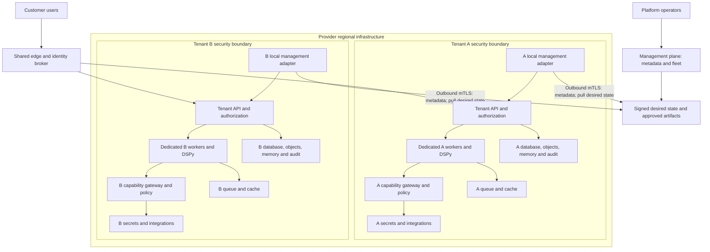
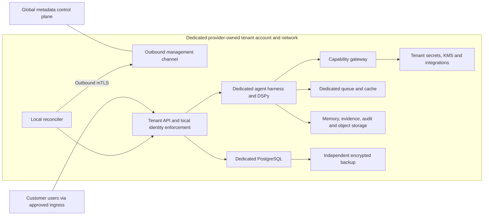
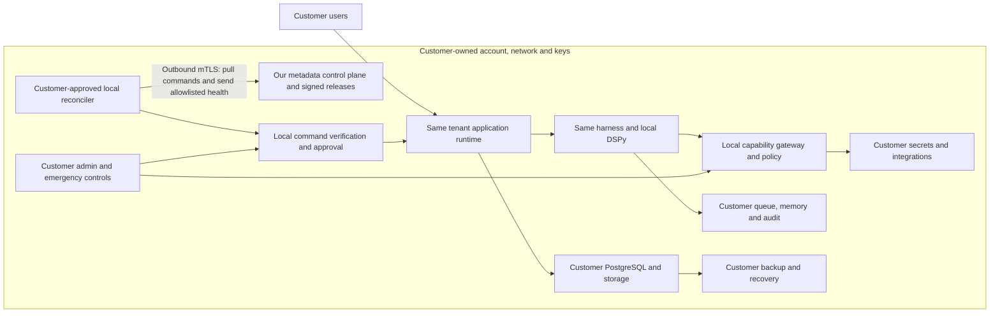

# Deployment models

Design contract v1; proposed behavior unless linked as existing audit evidence.
All modes use the same application images, agent harness, DSPy adapter and release
manifest. Mode changes placement and isolation bindings, not domain behavior.
One tenant is one customer security boundary; an organization owns one or more
tenants (for region/environment segregation), and a tenant may have multiple
deployments. Each data-plane deployment belongs to exactly one tenant initially.
Tenant IDs are immutable, opaque and never reused after deletion.

## Multi-tenant SaaS: Phase 4 target

Shared SaaS is a shared service experience and management infrastructure; it does
not require shared customer rows or a multi-customer agent process. Initially
share edge, identity federation, signed artifact distribution and metadata fleet
services. Regional clusters may share orchestration with dedicated tenant node
pools/VMs, deny-by-default networking and no customer Kubernetes access. A shared
Kubernetes administrator remains a cross-tenant trust risk. Cluster-per-tenant is
available when that risk is unacceptable. API routing resolves deployment from
verified membership, never caller-supplied database addresses or headers.

Later API/queue/database consolidation requires the subsystem's tests, cost evidence,
an explicit threat-model amendment and a migration rehearsal. Dedicated execution
workers remain the default even after other infrastructure is shared.

## Single-tenant managed: Phase 3 MVP

Default a provider-owned account/project, VPC and application cluster per customer;
dedicated VM capacity, database instance and storage. Key policies, integration
credentials, ingress, egress, backup schedules and retention are customer-specific.
Upgrade one deployment without changing another. Account separation reduces blast
radius but does not remove provider organization-administrator trust.

## BYOC: Phase 5

The arrow to management is initiated locally. Responses contain constrained
commands/artifacts, not a general reverse shell. Tenant data APIs use a separate
customer-approved ingress/private access path; management is not their proxy.
Local enforcement has no synchronous dependency on our management service.

## Ownership and responsibility

| Area | SaaS | Managed dedicated | BYOC |
|---|---|---|---|
| Account, network and storage ownership | Provider | Provider, dedicated | Customer |
| Customer data ownership | Customer | Customer | Customer |
| Runtime operation | Provider | Provider | Provider/co-managed within granted scope |
| Tenant secrets | Tenant-scoped local service | Dedicated local service | Customer-owned store; references only centrally |
| Key custody | Provider tenant key, customer option | Dedicated tenant key | Customer-managed/approved key |
| Upgrade authority | Provider within service policy | Tenant maintenance policy | Customer-approved standing or one-time policy |
| Evidence/support access | Explicit tenant-scoped elevation | Explicit tenant-scoped elevation | Customer-approved local elevation |
| Local safety when management fails | Required | Required | Required |

The minimum MVP, migration order and release blockers are in
[migration strategy](migration-strategy.md). No mode is production-ready at the audited baseline.
