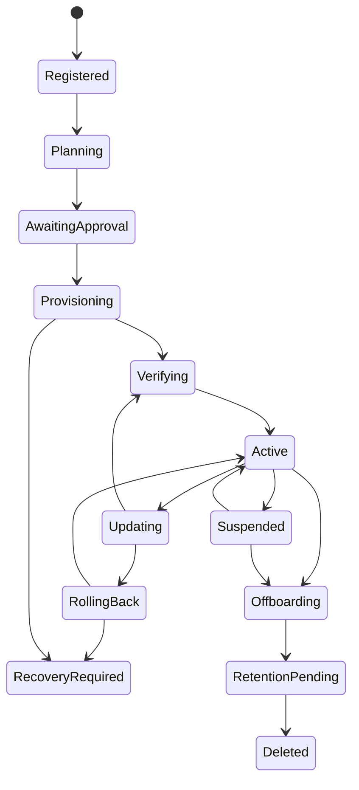

# Managed service lifecycle and deployment abstraction

Decision D07: a versioned DeploymentManifest is the portable desired-state contract.
An adapter reconciles it to cloud infrastructure and application releases. The global
plane owns inventory and requested state; the local adapter owns effective state and
customer policy enforcement. BYOC uses the same adapter protocol with customer-owned
apply authority. No tenant-facing API accepts arbitrary IaC, shell or Helm overrides.

## Tooling choice

Use **Pulumi Go** for the initial account/network/database/storage/key modules and
**Helm** for the Vigil application. Terraform or OpenTofu are alternatives only if
customer platform standards require them; qualify versions, providers and state
compatibility rather than assuming a state file is interchangeable. Separate provider
modules and pin provider locks/module digests. Both tools need a reconciler/operation
journal; neither alone is a fleet control plane. Pulumi state locking depends on backend
support, and sensitive values can remain in state. [Pulumi state and secrets](https://www.pulumi.com/docs/concepts/state/),
[Pulumi Go](https://www.pulumi.com/docs/iac/languages-sdks/go/).

Reuse `infra/helm/vigil` for application components, external Postgres/Redis, probes,
Secrets references and autoscaling. Managed overlays must fix the audited network
defaults, apply workload IAM, isolate state volumes, pin image digests, split runtime
and migration roles and establish recovery hooks. Do not treat `helm rollback` as a
database rollback. Docker Compose is a developer/lab baseline; hardcoded names/ports
and local volumes need redesign before multiple instances on one host are safe.

## Manifest fields

The [example manifest](contracts/deployment-manifest.example.json) captures the proposed
shape. It is non-executable design input with synthetic references, not a provisioning
template. No secret material belongs in manifests, plans, outputs or central state.

| Group | Required content |
|---|---|
| Identity | Contract version, immutable tenant/deployment IDs, installation incarnation |
| Placement | Mode, cloud adapter, bound account/project, region, permitted zones |
| Releases | Independent application, harness, DSPy, policy, schema and infrastructure revisions/digests |
| Configuration | Non-secret typed settings, feature flags bounded by entitlements, customer approval policy |
| Credentials | Local opaque refs and intended workload/action scope |
| Networking | Customer-approved ingress, egress, private connectivity, DNS/time and registry/model endpoints |
| Storage | Database/object/index/queue refs, region, key refs, retention and deletion policy |
| Operations | Budgets, health/export schema, backup targets, RPO/RTO targets, maintenance window, rollback compatibility |

## Reconciliation state machine

Each operation records tenant/deployment, immutable plan hash, idempotency key, desired
and observed generations, scoped actor/approval, resource inventory, checkpoints,
attempt count, last error code and compensation plan. Lock by deployment and state
backend; use fencing tokens so a restarted/stale reconciler cannot continue mutation.
Retry transient failures with backoff; permanent policy/compatibility failures require
a new approved plan. Rollback failure quarantines the affected plane and preserves data.

Before mutation, verify the caller's deployment binding and cloud account identity;
match existing resources by both immutable IDs and state lineage. Never adopt or delete
resources merely because a tenant supplies their name. Separate state, credentials and
runner work directories per deployment. A shared scheduler cannot read all customer
state or assume arbitrary customer roles. BYOC plan/apply and sensitive state stay local.

## Standard operations and recovery

| Interface | Recovery / security invariant |
|---|---|
| `provision` | Reapply converges without duplicate tenants, keys or databases; partial inventory retained |
| `configure` | Validate schema and local constraints, compare generation, atomically activate revision |
| `credentialRefs` | Verify reference ownership; resolve only locally; rotation versioned without exporting value |
| `network` | Plan reachability and deny tests before enforcement; retain local emergency access |
| `health` | Liveness vs readiness vs enforcement-ready are distinct; status freshness explicit |
| `backup / recover` | Snapshot receipt + restore validation + key availability; restoration starts quarantined |
| `upgrade / rollback` | Tested compatibility tuple, drain/checkpoint, recovery point; no irreversible automatic down migration |
| `suspend` | Stop scoped new automation, preserve local enforcement/data and emergency controls |
| `offboard / delete` | Customer authorization, legal hold, export, revocation, per-store receipts and backup expiry |
| `meter` | Monotonic sequence and idempotent event ID; late records reconcile without double billing |

An onboarding operation becomes Active only after bootstrap identity, health,
credential scope, synthetic cross-tenant negative probes, backups and recovery plan
are verified. Billing activation does not override a failed security readiness gate.
